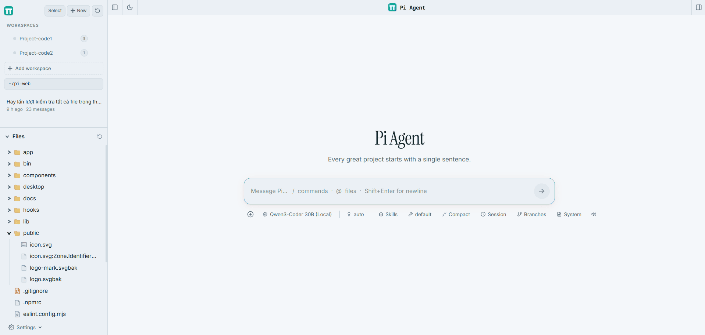
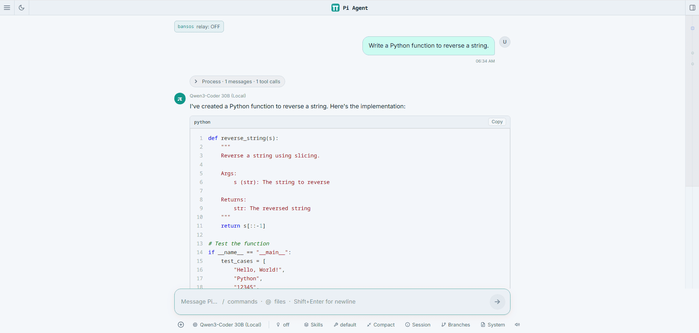
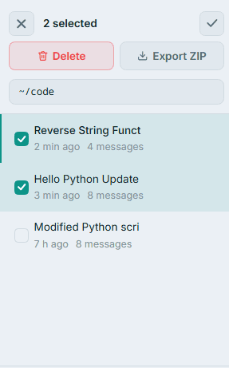
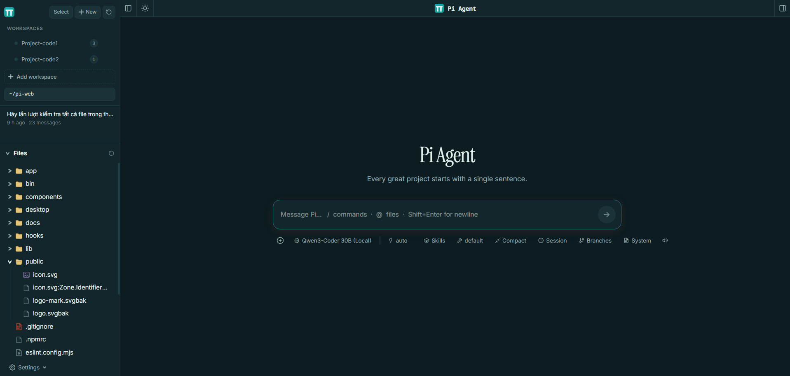
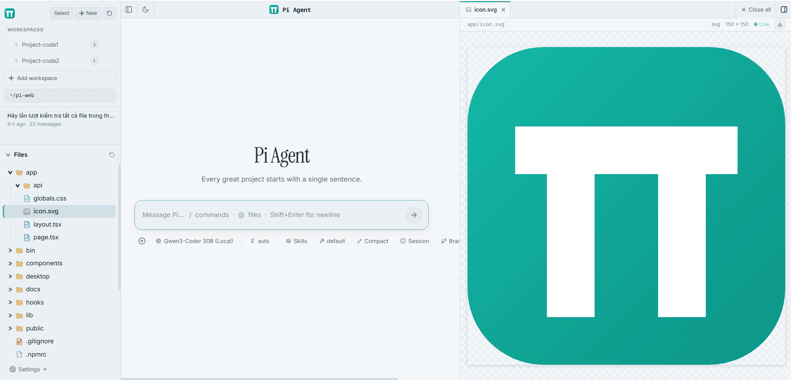

<div align="center">


# Pi Web

**A browser-based interface for the [Pi coding agent](https://github.com/earendil-works/pi-coding-agent)**

Browse sessions, chat with AI models, and manage your project files — all from a local web UI.

**English** | [Tiếng Việt](README.vi.md)

[](LICENSE)
[](https://nextjs.org)
[](https://react.dev)
[](https://www.typescriptlang.org)

</div>

---

## ⚠️ Fork Notice

This is a **personal fork** of [`agegr/pi-web`](https://github.com/agegr/pi-web), which itself is a fork of [`tingwdsj/pi-web`](https://github.com/tingwdsj/pi-web). All architecture and the original feature set come from upstream. This fork focuses on **usability, aesthetics, and the English-speaking audience**.

### What's different from upstream

| Change | Description |
| :--- | :--- |
| 🌐 **English UI** | Complete translation from the original Chinese interface — every label, error message, and prompt |
| 🎨 **Aqua theme** | Cool blue-gray surface with a teal accent, in both light and dark variants |
| ☑️ **Bulk session management** | Select multiple sessions and delete or export them as a ZIP archive in one go |
| 🗂️ **Workspaces panel** | Group projects into named workspaces with drag-to-reorder and `Ctrl+1..9` shortcuts |
| 🖼️ **New logo** | Teal-gradient π mark matching the new theme |
| 🧹 **Cleaner repo** | Removed Chinese-only docs, unused lockfiles, and legacy files |

Original work and architecture by [@tingwdsj](https://github.com/tingwdsj) and [@agegr](https://github.com/agegr). Full credit to the upstream project.

---

## 📸 Screenshots

### Main interface

Session sidebar on the left, chat window in the center, and an optional file panel on the right.



### Chat with AI

Markdown rendering, syntax-highlighted code blocks, and per-message token stats.



### Bulk session management

Select multiple sessions to delete or export them as a single ZIP archive.



### Light and dark mode

<table>
<tr>
<td width="50%">

**Light**


</td>
<td width="50%">

**Dark**


</td>
</tr>
</table>

### File viewer

Syntax-highlighted preview for 30+ languages, with line numbers and a tab bar.



---

## ✨ Features

### Core
- **Multi-provider support** — Ollama (local), Groq, OpenRouter, xAI, Anthropic, or any OpenAI-compatible endpoint
- **Streaming responses** — real-time token display with a tokens/sec indicator
- **Session browser** — sidebar with running/unread indicators, relative timestamps, and fork tree
- **File explorer** — tree view with type-aware icons; click to preview in the right panel
- **Built-in file viewer** — syntax highlighting, markdown preview, image/PDF/DOCX/XLSX rendering
- **Branch navigation** — fork a conversation from any message and switch between branches
- **Skills & plugins** — install, upload (ZIP), enable or disable from the UI
- **Worktree support** — manage git worktrees per project

### Added by this fork
- **English translation** — UI, errors, and system prompts
- **Aqua theme** — light and dark variants with a fresh teal accent
- **Bulk session management** — checkbox select mode with batch delete and ZIP export
- **Workspaces panel** — group projects, reorder, and switch with `Ctrl+1..9`
- **Auto-open browser** — optional wrapper script that launches the app in your default browser

---

## 🚀 Quick Start

### Requirements

- **Node.js** ≥ 22.19.0
- **npm** ≥ 10
- **[Pi coding agent](https://github.com/earendil-works/pi-coding-agent)** installed globally

### Install

```bash
# 1. Clone
git clone https://github.com/datnguyentien2006/pi-web.git
cd pi-web

# 2. Install dependencies
npm install

# 3. Build for production
npm run build

# 4. Install globally
npm install -g .

# 5. Run
pi-web
```

Then open <http://localhost:30141> in your browser.

### Development mode

```bash
npm run dev
```

Starts the Next.js dev server on <http://localhost:30141> with hot reload.

---

## ⚙️ Configuration

### Model providers

Configure providers in `~/.pi/agent/models.json`:

```json
{
  "providers": {
    "ollama": {
      "baseUrl": "http://localhost:11434/v1",
      "api": "openai-completions",
      "apiKey": "ollama",
      "compat": {
        "supportsDeveloperRole": false,
        "supportsReasoningEffort": false
      },
      "models": [
        {
          "id": "qwen2.5-coder:7b",
          "name": "Qwen2.5 Coder 7B (Local)",
          "contextWindow": 32768,
          "maxTokens": 8192
        }
      ]
    },
    "groq": {
      "baseUrl": "https://api.groq.com/openai/v1",
      "api": "openai-completions",
      "apiKey": "$GROQ_API_KEY",
      "compat": {
        "supportsDeveloperRole": true,
        "supportsReasoningEffort": true
      },
      "models": [
        {
          "id": "openai/gpt-oss-120b",
          "name": "GPT-OSS 120B (Groq)",
          "contextWindow": 131072,
          "maxTokens": 65536
        }
      ]
    }
  }
}
```

Set the default model in `~/.pi/agent/settings.json`:

```json
{
  "defaultProvider": "groq",
  "defaultModel": "openai/gpt-oss-120b"
}
```

Export API keys in `~/.bashrc`:

```bash
export GROQ_API_KEY="gsk_..."
export OPENROUTER_API_KEY="sk-or-..."
```

### Custom port

The default port is **30141**. Change it in `package.json`:

```json
{
  "scripts": {
    "dev": "next dev -p 30141",
    "start": "next start -p 30141"
  }
}
```

---

## ⌨️ Keyboard Shortcuts

### Chat input

| Key | Action |
| :--- | :--- |
| `Enter` | Send message |
| `Shift + Enter` / `Ctrl + J` | New line |
| `Ctrl + A` | Move to line start |
| `Ctrl + E` | Move to line end |
| `Ctrl + W` | Delete word backward |
| `Ctrl + U` | Delete to line start |
| `Ctrl + K` | Delete to line end |
| `Ctrl + Y` | Paste last deleted text |
| `/` | Slash commands |
| `@` | Reference files |

### Session sidebar

| Key | Action |
| :--- | :--- |
| `Ctrl + 1..9` | Switch to workspace N |
| `Ctrl + N` | New session |
| Click logo | Toggle π digit display |

---

## 🛠️ Development

### Project structure

```
pi-web/
├── app/                  # Next.js App Router (pages + API routes)
│   ├── api/              #   Backend endpoints
│   ├── layout.tsx        #   Global layout
│   ├── page.tsx          #   Main page entry
│   └── globals.css       #   Global styles and theme tokens
├── components/           # Reusable React components
├── hooks/                # Client-side hooks
├── lib/                  # Shared logic (session reader, RPC, file access)
├── desktop/              # Electron packaging (optional)
├── bin/                  # CLI entry points
├── public/               # Static assets
├── docs/                 # Documentation
│   └── screenshots/      # README screenshots
└── package.json
```

### Scripts

```bash
npm run dev      # Dev server with hot reload
npm run build    # Production build
npm start        # Run the production build
npm run lint     # ESLint
```

### Tech stack

- **Next.js 16** (App Router, Webpack)
- **React 19**
- **TypeScript 5**
- **Tailwind CSS 4**
- **[pi-coding-agent](https://github.com/earendil-works/pi-coding-agent)** — agent runtime and session management
- **react-markdown** + **react-syntax-highlighter** — message rendering

---

## 🏗️ Architecture

Pi Web is a thin web layer around `pi-coding-agent`:

```
Browser (Next.js UI)
        │
        ▼
   HTTP / SSE
        │
        ▼
Next.js API routes  ──►  pi-coding-agent (Node process)
        │                        │
        │                        ▼
        │                 Session files (~/.pi/agent/sessions/)
        │                 Model registry (~/.pi/agent/models.json)
        │                 Skills / plugins (~/.pi/agent/skills/)
        ▼
  Static file serving (public/)
```

- **No separate backend** — API routes run inside Next.js
- **No database** — sessions are JSON files on disk
- **No authentication** — designed for local use only

---

## 🖥️ Desktop App (Optional)

The repo includes Electron packaging under `desktop/`. To build a native bundle:

```bash
npm run desktop:build
```

Output goes to `desktop/dist/` (ignored by Git). Platform-specific:
- **macOS** — `.dmg` (arm64 + x64)
- **Windows** — `.exe` installer
- **Linux** — `.AppImage`

---

## 🙏 Credits

- **Original project** — [`tingwdsj/pi-web`](https://github.com/tingwdsj/pi-web) by [@tingwdsj](https://github.com/tingwdsj)
- **Intermediate fork** — [`agegr/pi-web`](https://github.com/agegr/pi-web) by [@agegr](https://github.com/agegr)
- **Agent runtime** — [`pi-coding-agent`](https://github.com/earendil-works/pi-coding-agent)
- **This fork** — [@datnguyentien2006](https://github.com/datnguyentien2006)

Special thanks to the upstream contributors for the original architecture and feature set.

---

## 📄 License

[MIT](LICENSE) — same as the upstream project.
