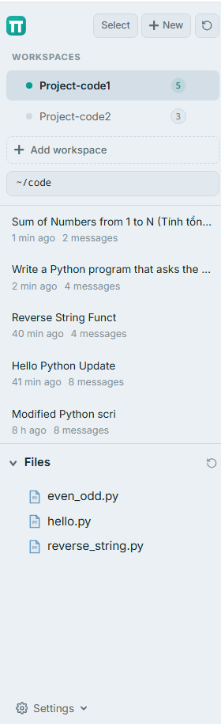

<div align="center">


# Pi Web

**A browser-based interface for the [Pi coding agent](https://github.com/earendil-works/pi-coding-agent)**

Browse sessions, chat with AI models, and manage your project files — all from a local web UI.

**English** | [Tiếng Việt](README.vi.md)

[](LICENSE)
[](https://nextjs.org)
[](https://react.dev)
[](https://www.typescriptlang.org)

</div>

---

## ⚠️ Fork Notice

This is a **personal fork** of [`agegr/pi-web`](https://github.com/agegr/pi-web), which itself is a fork of [`tingwdsj/pi-web`](https://github.com/tingwdsj/pi-web). All architecture and the original feature set come from upstream. This fork focuses on **usability, aesthetics, and the English-speaking audience**.

### What's different from upstream

| Change | Description |
| :--- | :--- |
| 🌐 **English UI** | Complete translation from the original Chinese interface — every label, error message, and prompt |
| 🎨 **Aqua theme** | Cool blue-gray surface with a teal accent, in both light and dark variants |
| ☑️ **Bulk session management** | Select multiple sessions and delete or export them as a ZIP archive in one go |
| 🗂️ **Workspaces** | Run multiple projects side-by-side, switch with `Ctrl+1..9`, jump back to any context in one keystroke |
| 🖱️ **Drag-to-reorder + naming** | Rename, reorder, delete workspaces from the UI without editing config files |
| 🖼️ **New logo** | Teal-gradient π mark matching the new theme |
| 🧹 **Cleaner repo** | Removed Chinese-only docs, unused lockfiles, and legacy files |

Original work and architecture by [@tingwdsj](https://github.com/tingwdsj) and [@agegr](https://github.com/agegr). Full credit to the upstream project.

---

## 📸 Screenshots

### Main interface

Session sidebar on the left, chat window in the center, and an optional file panel on the right.


### Chat with AI

Markdown rendering, syntax-highlighted code blocks, and per-message token stats.


### Bulk session management

Select multiple sessions to delete or export them as a single ZIP archive.


### Workspaces

Run multiple projects side-by-side — each workspace keeps its own session list, file tree, and git worktree state. Switch with `Ctrl+1` through `Ctrl+9`.



### Light and dark mode

<table>
<tr>
<td width="50%">

**Light**


</td>
<td width="50%">

**Dark**


</td>
</tr>
</table>

### File viewer

Syntax-highlighted preview for 30+ languages, with line numbers and a tab bar.


---

## ✨ Features

### Core
- **Multi-provider support** — Ollama (local), Groq, OpenRouter, xAI, Anthropic, or any OpenAI-compatible endpoint
- **Streaming responses** — real-time token display with a tokens/sec indicator
- **Session browser** — sidebar with running/unread indicators, relative timestamps, and fork tree
- **File explorer** — tree view with type-aware icons; click to preview in the right panel
- **Built-in file viewer** — syntax highlighting, markdown preview, image/PDF/DOCX/XLSX rendering
- **Branch navigation** — fork a conversation from any message and switch between branches
- **Skills & plugins** — install, upload (ZIP), enable or disable from the UI
- **Worktree support** — manage git worktrees per project

### Added by this fork
- **English translation** — UI, errors, and system prompts
- **Aqua theme** — light and dark variants with a fresh teal accent
- **Bulk session management** — checkbox select mode with batch delete and ZIP export
- **Workspaces panel** — group projects, reorder, and switch with `Ctrl+1..9`
- **Auto-open browser** — optional wrapper script that launches the app in your default browser

---

## 🗂️ Workspaces

Workspaces are this fork's biggest addition over the upstream project. They let you **run multiple projects in parallel** without ever opening a second browser tab — each workspace keeps its own sessions, file tree, cwd, and git worktree state.

### Why this matters

Upstream `pi-web` shows a single flat list of sessions. When you're juggling several projects — say `frontend`, `backend`, and `infra` — you end up scrolling past unrelated sessions to find the one you want, and the file explorer and git worktree switcher keep flipping between repos.

Workspaces fix this by letting you **group sessions, files, and git context by project** and switch between them instantly.

### Key concepts

| Concept | Meaning |
| :--- | :--- |
| **Workspace** | A named group pointing to a project root directory |
| **Active workspace** | The one currently shown in the sidebar; highlighted with an accent bar |
| **Session count** | Small badge next to each workspace showing how many sessions it contains |
| **Blocked switch** | If any agent is running, switching workspaces is temporarily blocked to prevent cross-project data leaks |

### What each workspace isolates

When you switch workspaces, these things change together:

- **Session list** — only sessions belonging to that project root are shown
- **File tree** — the file explorer re-roots to the workspace directory
- **Effective cwd** — new sessions spawn in the workspace directory
- **Worktree switcher** — git worktrees are scoped per project
- **Workspace path input** — shows the workspace root instead of raw `~`

### How to use

**Create a workspace:**

1. Click **"+ Add workspace"** at the top of the sidebar
2. In the modal, choose:
   - **Name** — a label to recognize it later (e.g. `Frontend`, `API`, `Infra`)
   - **Path** — the project root directory (validate via OS picker or manual entry)
   - Optional: an accent color and short description
3. Save. The workspace appears at the top of the sidebar.

**Switch between workspaces:**

- **Click** a workspace in the list
- Or press **`Ctrl+1`**, **`Ctrl+2`**, ... **`Ctrl+9`** to jump to the Nth workspace

**Reorder:**

- Drag and drop a workspace up or down — the order persists across reloads

**Edit or delete:**

- Hover a workspace, click the **⋯** menu
- **Edit** opens the same modal with values pre-filled
- **Delete** removes the workspace (does not delete the project or any sessions)

**Blocking rule:**

While any agent is running, switching workspaces is blocked and a toast appears: *"Wait for the running agent to finish (or cancel it) before switching workspaces."* This prevents in-flight tool calls from writing to the wrong project.

### Example workflow

Imagine you have three projects and one AI assistant. Without workspaces:

```
1. Open pi-web
2. Scroll through 40 sessions to find the one from "frontend-app"
3. File tree shows "backend" by accident — click around to fix it
4. Start a new session — it spawns in the wrong repo
5. Realize you were editing the wrong branch
```

With workspaces:

```
1. Open pi-web
2. Press Ctrl+1 → instantly see "Frontend" workspace
3. File tree is already rooted at the frontend repo
4. Start a new session — it spawns in frontend/ with the right branch
5. Press Ctrl+2 → switch to "Backend" without losing context
```

### Storage

Workspaces are stored in `~/.pi/agent/workspaces.json`:

```json
{
  "version": 1,
  "activeWorkspaceId": "ws_abc123",
  "workspaces": [
    {
      "id": "ws_abc123",
      "name": "Frontend",
      "path": "/home/user/code/frontend",
      "color": "#0D9488",
      "createdAt": "2026-01-12T10:30:00Z"
    },
    {
      "id": "ws_def456",
      "name": "Backend",
      "path": "/home/user/code/backend",
      "color": "#14B8A6"
    }
  ]
}
```

The file is created automatically on first save. You can also edit it manually if you prefer — Pi Web reads it on startup.

### Keyboard shortcuts

| Key | Action |
| :--- | :--- |
| `Ctrl + 1` … `Ctrl + 9` | Jump to workspace 1 through 9 |
| `Click ⋯ menu` | Open edit / delete actions for a workspace |
| `Drag workspace` | Reorder within the list |

Shortcuts are **disabled** while:
- A modal is open
- Focus is inside a text input or textarea
- Any agent is currently running

---

## 🚀 Quick Start

### Requirements

- **Node.js** ≥ 22.19.0
- **npm** ≥ 10
- **[Pi coding agent](https://github.com/earendil-works/pi-coding-agent)** installed globally

### Install

```bash
# 1. Clone
git clone https://github.com/datnguyentien2006/pi-web.git
cd pi-web

# 2. Install dependencies
npm install

# 3. Build for production
npm run build

# 4. Install globally
npm install -g .

# 5. Run
pi-web
```

Then open <http://localhost:30141> in your browser.

### Development mode

```bash
npm run dev
```

Starts the Next.js dev server on <http://localhost:30141> with hot reload.

---

## 🌐 Auto-open Browser (optional)

By default, `pi-web` starts a local server but doesn't open the browser — you have to manually visit <http://localhost:30141>. If you want `pi-web` to launch the browser automatically (e.g. for `pi-web` used inside WSL2 or a headless environment), add a shell wrapper that polls the server and opens the URL when ready.

### Setup (WSL2 / Linux)

Append this to `~/.bashrc`:

```bash
# ── pi-web wrapper: start server and open the browser ──
pi-web() {
  local pi_web_bin
  pi_web_bin=$(type -P pi-web)
  if [ -z "$pi_web_bin" ]; then
    echo "Error: pi-web binary not found in PATH" >&2
    return 1
  fi

  # Read port from package.json (fallback: 30141)
  local port
  port=$(grep -oP '"dev":\s*"next dev -p \K\d+' ~/pi-web/package.json 2>/dev/null | head -1)
  port="${port:-30141}"
  local url="http://localhost:${port}"

  echo "[pi-web] Starting server on ${url}"
  "$pi_web_bin" "$@" &
  local pid=$!

  # Wait until the server responds (max 30s)
  local waited=0
  while [ $waited -lt 60 ]; do
    if ! kill -0 $pid 2>/dev/null; then
      wait $pid
      return $?
    fi
    local code
    code=$(curl -s -o /dev/null -w "%{http_code}" "$url" 2>/dev/null)
    case "$code" in
      200|301|302|404) break ;;
    esac
    sleep 0.5
    waited=$((waited + 1))
  done

  # Open in the Windows default browser (WSL2)
  if command -v powershell.exe >/dev/null 2>&1; then
    powershell.exe -NoProfile -Command "Start-Process '${url}'" >/dev/null 2>&1 &
  elif command -v xdg-open >/dev/null 2>&1; then
    xdg-open "${url}" >/dev/null 2>&1 &
  elif command -v open >/dev/null 2>&1; then
    open "${url}" >/dev/null 2>&1 &
  else
    echo "[pi-web] Could not detect a browser opener. Open manually: ${url}"
  fi

  echo "[pi-web] Browser opening at ${url}  (Ctrl+C to stop)"
  wait $pid
}
```

Reload your shell:

```bash
source ~/.bashrc
```

### Usage

Just run:

```bash
pi-web
```

The wrapper will:
1. Start the server in the background.
2. Poll `http://localhost:30141` until it returns a response.
3. Open the default browser (Windows browser from WSL2, `xdg-open` on Linux, `open` on macOS).
4. Keep the server in the foreground so `Ctrl+C` stops it.

**Note:** the wrapper **overrides** the original `pi-web` command. If you ever need the original behavior without browser auto-open, use `command pi-web` to bypass the function.

---

## ⚙️ Configuration

Pi Web **does not manage models or providers itself** — it reads whatever `pi-coding-agent` already has configured on your machine. If you've been using the Pi CLI or desktop app, your settings are picked up automatically with no extra steps.

| File | Purpose |
| :--- | :--- |
| `~/.pi/agent/models.json` | Provider definitions and model registry |
| `~/.pi/agent/settings.json` | Default provider, default model, and other runtime preferences |

Pi Web works with **any configuration `pi-coding-agent` accepts**:

- **Local runtimes** — Ollama, LM Studio, llama.cpp, vLLM, or any OpenAI-compatible endpoint
- **Cloud providers** — Groq, OpenRouter, Anthropic, xAI, Gemini, Mistral, Together, Fireworks, or any OpenAI-compatible API
- **Custom extensions** — plugins that register providers programmatically at runtime
- **Pre-existing setups** — if you already have `~/.pi/agent/models.json`, it just works

For the full reference (structure, `compat` flags, troubleshooting), see the [`pi-coding-agent` documentation](https://github.com/earendil-works/pi-coding-agent).

### Custom port

The default port is **30141**. Change it in `package.json`:

```json
{
  "scripts": {
    "dev": "next dev -p 30141",
    "start": "next start -p 30141"
  }
}
```

---

## ⌨️ Keyboard Shortcuts

Pi Web runs in the browser, so it uses two layers of shortcuts: **app-specific** ones handled by the UI, and **native browser** ones handled by Chrome / Firefox / Edge.

### Chat input

| Key | Action |
| :--- | :--- |
| `Enter` | Send message |
| `Shift + Enter` | Insert a new line |
| `/` | Open slash-command menu |
| `@` | Open file-reference autocomplete |
| `Escape` | Close the autocomplete menu or cancel streaming |
| `↑` / `↓` | Navigate autocomplete suggestions (when menu is open) |

Standard text-editing keys use the browser's native behavior:

| Key | Action |
| :--- | :--- |
| `Ctrl + C` / `Ctrl + V` / `Ctrl + X` | Copy / paste / cut |
| `Ctrl + A` | Select all text in the textarea |
| `Ctrl + Z` | Undo |
| `Ctrl + Y` or `Ctrl + Shift + Z` | Redo |
| `Ctrl + ←` / `Ctrl + →` | Move cursor by word |

> ⚠️ **Do not use `Ctrl + W`** while focused in the textarea — browsers bind it to "close tab" and you will lose the page. Use `Ctrl + Backspace` instead to delete a word.

### Session sidebar

| Key | Action |
| :--- | :--- |
| `Ctrl + 1` … `Ctrl + 9` | Switch to workspace N (when at least one workspace is defined) |
| Click the π logo | Toggle the π digit display next to the logo |

### Global browser shortcuts (outside the app)

| Key | Action |
| :--- | :--- |
| `Ctrl + Shift + R` | Hard refresh — needed after `npm run build && npm install -g .` |
| `Ctrl + 0` | Reset zoom to 100% |
| `F12` | Open DevTools (useful for troubleshooting) |

---

## 🛠️ Development

### Project structure

```
pi-web/
├── app/                  # Next.js App Router (pages + API routes)
│   ├── api/              #   Backend endpoints
│   ├── layout.tsx        #   Global layout
│   ├── page.tsx          #   Main page entry
│   └── globals.css       #   Global styles and theme tokens
├── components/           # Reusable React components
├── hooks/                # Client-side hooks
├── lib/                  # Shared logic (session reader, RPC, file access)
├── desktop/              # Electron packaging (optional)
├── bin/                  # CLI entry points
├── public/               # Static assets
├── docs/                 # Documentation
│   └── screenshots/      # README screenshots
└── package.json
```

### Scripts

```bash
npm run dev      # Dev server with hot reload
npm run build    # Production build
npm start        # Run the production build
npm run lint     # ESLint
```

### Tech stack

- **Next.js 16** (App Router, Webpack)
- **React 19**
- **TypeScript 5**
- **Tailwind CSS 4**
- **[pi-coding-agent](https://github.com/earendil-works/pi-coding-agent)** — agent runtime and session management
- **react-markdown** + **react-syntax-highlighter** — message rendering

---

## 🏗️ Architecture

Pi Web is a thin web layer around `pi-coding-agent`:

```
Browser (Next.js UI)
        │
        ▼
   HTTP / SSE
        │
        ▼
Next.js API routes  ──►  pi-coding-agent (Node process)
        │                        │
        │                        ▼
        │                 Session files (~/.pi/agent/sessions/)
        │                 Model registry (~/.pi/agent/models.json)
        │                 Skills / plugins (~/.pi/agent/skills/)
        ▼
  Static file serving (public/)
```

- **No separate backend** — API routes run inside Next.js
- **No database** — sessions are JSON files on disk
- **No authentication** — designed for local use only

---

## 🖥️ Desktop App (Optional)

The repo includes Electron packaging under `desktop/`. To build a native bundle:

```bash
npm run desktop:build
```

Output goes to `desktop/dist/` (ignored by Git). Platform-specific:
- **macOS** — `.dmg` (arm64 + x64)
- **Windows** — `.exe` installer
- **Linux** — `.AppImage`

---

## 🙏 Credits

- **Original project** — [`tingwdsj/pi-web`](https://github.com/tingwdsj/pi-web) by [@tingwdsj](https://github.com/tingwdsj)
- **Intermediate fork** — [`agegr/pi-web`](https://github.com/agegr/pi-web) by [@agegr](https://github.com/agegr)
- **Agent runtime** — [`pi-coding-agent`](https://github.com/earendil-works/pi-coding-agent)
- **This fork** — [@datnguyentien2006](https://github.com/datnguyentien2006)

Special thanks to the upstream contributors for the original architecture and feature set.

---

## 📄 License

[MIT](LICENSE) — same as the upstream project.
